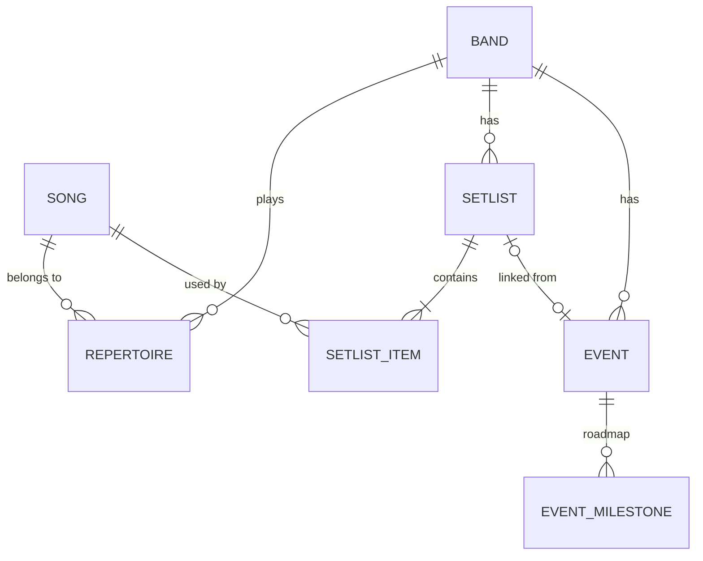

# Data model (MVP)

Logical model for TochLabs Setlist. It describes what is stored and which rules the data obeys. Table layout, Room annotations and migrations belong to the technical design (`openspec/changes/mvp-v1/design.md`).

Conventions: every entity has a UUID `id` plus `createdAt` and `updatedAt` timestamps. Names are English; the Spanish term used in earlier notes is shown in parentheses. Behavior is specified in `openspec/changes/mvp-v1/specs/`.

## Entity diagram

## Entities

### Band (Banda)
| Field | Type | Rules |
|---|---|---|
| name | text | Required, not blank after trimming |
| color | colour value | Required, used to tell bands apart |
| archivedAt | timestamp, nullable | Null = active. Not null = in the history |

### Song (Canción)
| Field | Type | Rules |
|---|---|---|
| title | text | Required, not blank after trimming |
| artist | text, nullable | |
| originalKey | text, nullable | Musical key as typed, for example `A`, `F#m` |
| originalBpm | integer, nullable | Positive |
| originalTuning | text, nullable | At most 20 characters. Null means standard tuning |
| durationSeconds | integer, nullable | Null means "no duration" and makes totals incomplete |

### Repertoire (Repertorio)
Join between Band and Song. Primary key is (`bandId`, `songId`). A song may belong to several bands.

### Setlist
| Field | Type | Rules |
|---|---|---|
| bandId | reference | Required, an active band at creation time |
| name | text | Required, not blank after trimming |
| date | date, nullable | Null means "no date" |
| pauseSeconds | integer | 0 to 120, steps of 5. Initialised from the default pause in the app settings (20 s until changed) |

### SetlistItem (ElementoSetlist)
Ordered by `position` (unique within a setlist). `kind` is `SONG` or `STOP`.

| Field | Applies to | Rules |
|---|---|---|
| setlistId, position, kind | both | Required |
| songId | SONG | Required for songs |
| keyOverride | SONG, nullable | Null = use the song's original key |
| bpmOverride | SONG, nullable | Null = use the song's original BPM. Positive |
| instrument | SONG, nullable | At most 20 characters, free text |
| tuningOverride | SONG, nullable | At most 20 characters. Null = use the song's original tuning |
| note | both, nullable | Free text |
| linkedToNext | SONG | Boolean. Only effective when the next item is a song |
| transitionText | SONG, nullable | Free text, for example "End on E" |
| stopType | STOP | `SPEECH`, `BREAK`, `TUNING`, `ENCORE` |
| durationSeconds | STOP | Required, positive. Default when adding a stop: 60 |

### Event (Evento)
| Field | Type | Rules |
|---|---|---|
| bandId | reference | Required |
| type | enum | `GIG` or `REHEARSAL` |
| date | date | Required |
| title | text | Required |
| venue, address, parking, contact | text, nullable | |
| setlistId | reference, nullable | Setlist of the same band. At most one event per setlist |

### EventMilestone (HitoEvento)
| Field | Type | Rules |
|---|---|---|
| eventId | reference | Required |
| kind | enum | `ARRIVAL`, `BACKLINE`, `SOUNDCHECK`, `ON_STAGE`, `GIG`, `PACK_UP`, `DEPARTURE`, `CUSTOM` |
| customLabel | text, nullable | Required when `kind` is `CUSTOM`. Standard kinds are labelled by the app in the current language |
| startTime | time | Required |
| endTime | time, nullable | Present for range milestones. Not before `startTime` |

## App settings
Stored in a single-row `app_settings` table (same Room database, see `design.md`): language (`SYSTEM`, `ES`, `EN`) and default pause between songs (seconds). Not related to the other entities.

## Derived values (never stored)
- **Effective value** of a setlist item: the override if present, otherwise the song's original.
- **Change markers**: instrument change, tuning change, key differs from original, tempo differs from original, repeated song.
- **Totals**: music-only and with stops, number of songs without duration, number of pauses and links. See the `setlist-duration` spec.
- **Setlist "has roadmap"**: true when an event references the setlist.
- **Upcoming or past**: from the setlist date and today's date.

## Deletion and archive rules
| Action | Effect |
|---|---|
| Archive band | Sets `archivedAt`. Its setlists and events are hidden by following the band; they have no flag of their own. Songs are unaffected |
| Restore band | Clears `archivedAt` |
| Delete band (only from history) | Deletes its repertoire entries, setlists with their items, and events with their milestones. Songs stay |
| Delete setlist | Deletes its items. A linked event keeps existing with `setlistId` cleared |
| Delete song | Refused while any setlist item uses it. Otherwise removes it and its repertoire entries |
| Delete event | Deletes its milestones |

## Open points
Listed in `docs/product/open-questions.md`.
