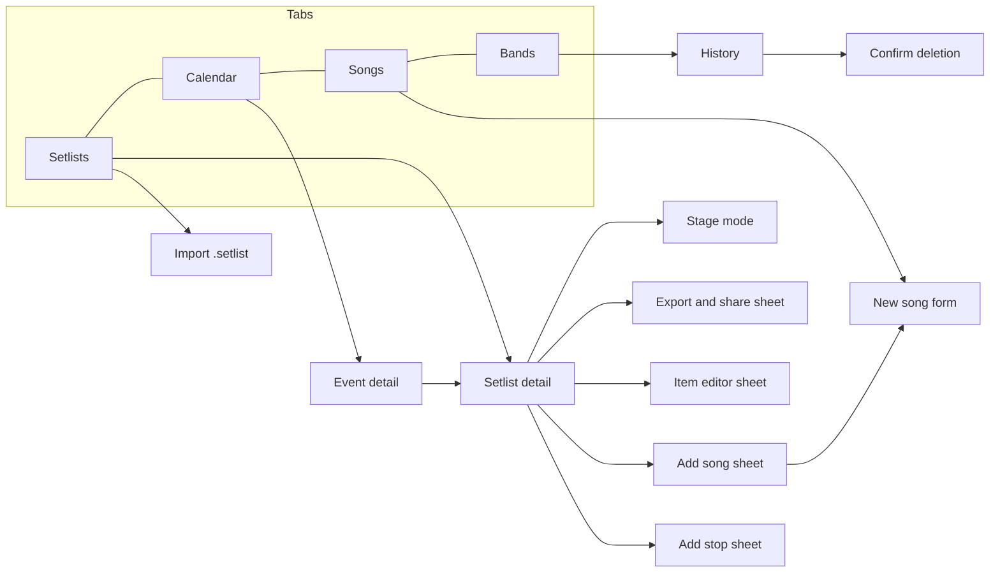

# Screens and flows (MVP)

Source: the interactive prototype "TochLabs Setlist — prototipo" (design canvas, Spanish) plus the agreed MVP scope. Behavior rules live in the specs (`openspec/changes/mvp-v1/specs/`). Screens marked **not prototyped** are in the MVP but have no prototype yet and must be designed before implementation.

## Navigation

Bottom navigation with four tabs: **Setlists**, **Calendar**, **Songs**, **Bands**. Settings are reached from the app bar.

## Screens

### Setlists (list)
- Band filter chips (all bands plus one chip per active band).
- **Upcoming** cards: name, band and date, number of songs, total with stops, badge "has roadmap" when an event is linked. Empty state: no upcoming setlists for this filter.
- **Past (n)** group with show and hide control.
- Actions: new setlist, import a `.setlist` file.

### Setlist detail
- Header: name, band, date, linked event (if any).
- Total card: switch between "with stops" and "music only", large total, song count, exact value, incomplete warning when songs lack duration, breakdown line.
- Pause between songs: stepper in 5 second steps.
- Item list: number, title, artist and instrument, change badges, key, BPM, duration, link indicator. Empty state with a prompt to add the first song.
- Reorder mode: toggle that shows move controls and allows dragging.
- Actions: add song, add stop, open stage mode, export and share.

### Add song sheet
Search the own catalogue (title and artist). Results show "already in setlist" when applicable; adding a repeated song warns the user. If nothing matches, offer to create a song with the typed title. A note explains that in this version songs are typed by hand.

### Song form (new or edit)
Title (required), artist, original key, original BPM, duration, original tuning (free text, 20 characters, with quick suggestions), bands that play it.

### Item editor sheet
Key and BPM for this setlist, instrument (20 characters with counter), tuning (20 characters with counter), note for the performance, link to the next song with transition text. Shows the song's original values for reference.

### Add stop sheet
Type (speech, break, tuning, encore), duration stepper (default 60 s). The stop is added at the end and then moved into place.

### Stage mode
Setlist name and position "n / total". Song: number, title, artist, key, BPM, duration, change markers, note, link text. Stop: type, duration, note. Next-item preview, previous and next buttons, horizontal swipe.

### Export and share sheet
Three modes: stage PDF, list PDF, file for the band (`.setlist`, with a summary of songs, stops and band). Actions: share, print (not available for the band file).

### Calendar
Monthly grid starting on Monday with event markers, month navigation, agenda for the selected day or the whole month.

### Event detail
Title, band and date, type, venue, address, parking, contact. Roadmap list with add-milestone action. Linked setlist (open it) or link one. The prototype also shows "open in maps" as coming soon.

### Songs (catalogue)
Band filter chips. Rows: title, artist and tuning, band dots, key, BPM, duration. A note explains that key, BPM and tuning are the originals and each setlist can override them.

### Bands
Band list with colour initial and summary, archive action. **History** section with restore and delete. Deleting opens a confirmation listing what will be removed (setlists, events, repertoire) and states that songs stay.

### Not prototyped (to design)
- Create and edit band.
- Create and edit setlist (name, band, date).
- Create and edit event; add, edit and remove milestones.
- Song detail with delete and the "in use" message.
- Delete setlist confirmation.
- Settings (language, default pause, about).
- Import flow: choose band, result summary and error messages.

## Main flows

1. **Build a setlist:** Setlists → new setlist → name, band, date → add songs (search or create) → add stops → reorder → adjust items → check the total.
2. **Prepare a gig:** Calendar → new event → fill logistics and milestones → link the setlist → review the roadmap.
3. **Share with the band:** Setlist detail → export → `.setlist` → share. Receiver opens the file → picks a band → new setlist created, missing songs added.
4. **On stage:** Setlist detail → stage mode → swipe through items.
5. **Retire a band:** Bands → archive → History → restore, or delete after confirmation.

## States and messages (from the prototype)
Short confirmations ("toasts") after saving a song, adding a song (with a duplicate warning), archiving and restoring a band. Empty states for no upcoming setlists, an empty setlist, an empty agenda and an empty search.
