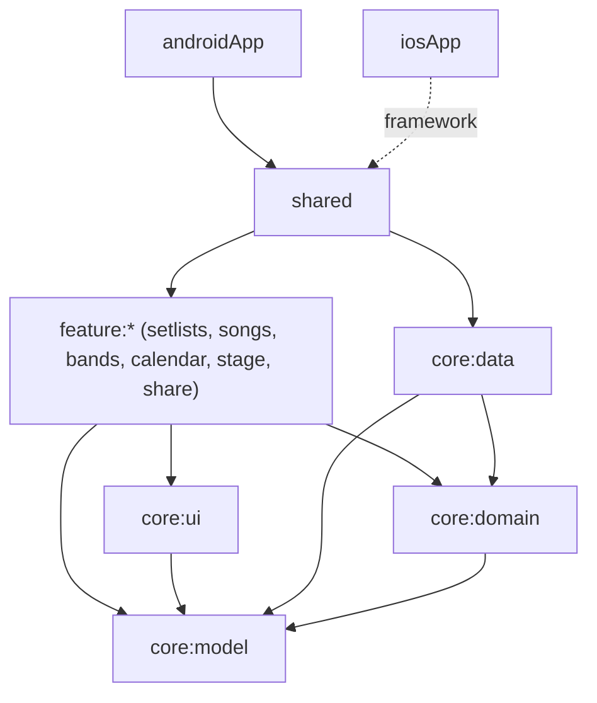
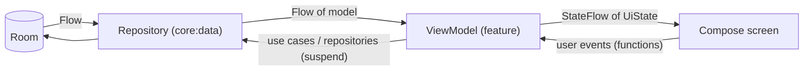

# Design

## Context

TochLabs Setlist is a greenfield Kotlin Multiplatform app (Android first, iOS after Android works). The repository already contains the generated scaffold, the module skeleton (`core:*`, `feature:*`, `shared`, `androidApp`, `iosApp`), convention plugins in `build-logic` and the version catalog. See `proposal.md` for motivation and `specs/` for behavior. Data entities are described in `docs/product/data-model.md`, screens in `docs/product/screens-and-flows.md`.

Constraints that shape the approach:
- Everything runs on the device; no network, no accounts (proposal, Out of scope).
- The developer works on Windows. iOS code can only be compiled and tested on macOS, so the Android path must be fully verifiable on Windows and Linux CI, and iOS verification is deferred to a macOS runner.
- The app is a public portfolio: clear boundaries, tests first for business rules, and documentation that explains the decisions.
- Build setup already in place: AGP 9.5.0, Gradle 9.6.0, Kotlin 2.4.21, Compose Multiplatform 1.12.2, `compileSdk` 37, `minSdk` 24. AGP 9 requires the Android application module (`androidApp`) to be separate from the multiplatform modules, which use the `com.android.kotlin.multiplatform.library` plugin.

## Goals / Non-Goals

**Goals:**
- Keep business rules (durations, links, change markers, validations, import matching) in pure Kotlin that is testable without Android, iOS, a database or a UI.
- One shared UI and one shared data layer for both platforms; platform code only where the platform forces it (database file location, PDF, print, share, file opening, locale).
- A dependency direction that the build enforces, so layers cannot leak into each other.
- A data layer that can evolve with explicit migrations from the first release.

**Non-Goals:**
- No network layer, sync or accounts in the MVP.
- No dependency on external song databases (planned for later versions; the song catalogue sits behind a repository interface so a data source can be added).
- No UI tests in the MVP (see test strategy).
- No Desktop or Web targets.

## Decisions

### 1. Architecture: layered modules with a one-way dependency rule



| Module | Contents | May depend on |
|---|---|---|
| `core:model` | Immutable domain types (Band, Song, Setlist, SetlistItem, Event, EventMilestone, value types for ids, durations and validated text) | nothing |
| `core:domain` | Repository interfaces, business rules as pure functions, use cases for multi-step operations, validation | `core:model` |
| `core:data` | Room database, DAOs, entity mappers, repository implementations, `.setlist` file codec, settings storage | `core:model`, `core:domain` |
| `core:ui` | Theme, shared components (chips, sheets, reorderable list, duration and date formatting), shared strings, locale override | `core:model` |
| `feature:*` | Screens, ViewModels and Koin module of one feature | `core:model`, `core:domain`, `core:ui` |
| `shared` | Composition root: Koin wiring, navigation, `App()`, iOS entry point, framework `Shared` | all of the above |
| `androidApp` | `Application`, `MainActivity`, manifest, intent filter for `.setlist` | `shared` |

Rationale: features never see `core:data`, so a screen cannot talk to Room by accident, and rules in `core:domain` cannot depend on Android. Alternative considered: one `shared` module with packages. Rejected because package rules are conventions; module dependencies are enforced by the compiler, and the structure was already agreed.

`core:domain` stays free of DI and platform code. Use cases are plain classes with constructor parameters; the wiring lives in `shared`.

### 2. Domain rules as pure functions, tested first

The rules that carry most of the risk are plain functions over model types:

```kotlin
// core:domain (sketch)
data class DurationSummary(
    val musicSeconds: Long,
    val stopsSeconds: Long,
    val pausesSeconds: Long,
    val pauseCount: Int,
    val linkedPairs: Int,
    val songsWithoutDuration: Int,
) {
    val totalWithStopsSeconds get() = musicSeconds + stopsSeconds + pausesSeconds
    val isComplete get() = songsWithoutDuration == 0
}

fun calculateDuration(items: List<ResolvedItem>, pauseSeconds: Int): DurationSummary
fun computeMarkers(items: List<ResolvedItem>): List<ItemMarkers?>
```

`ResolvedItem` is a setlist item together with its song, so the functions need no repository. Each scenario in `specs/setlist-duration` and `specs/setlists` (change markers, links, repeated songs) becomes a test with the scenario name, written before the implementation. The pause rule follows the spec: one pause per pair of consecutive items (songs or stops) that is not a linked pair of songs.

Validation (non-blank names and titles, 20-character limits, pause 0 to 120 in steps of 5) is returned as a typed result, not thrown, so ViewModels can show field errors.

Time is never read directly: `Clock` is injected wherever "today" matters (upcoming and past setlists). Dates use `kotlinx-datetime`; its version is checked when it is added.

### 3. Persistence: Room 3 with bundled SQLite

- **Room 3 (`androidx.room3`) 3.0.3**, stable since 2026-09-09. The 3.1.0 line is alpha and is not used. Room 3 is Kotlin and KSP only, coroutine-first, and its Gradle plugin is `androidx.room3`. Group and artifact names changed from Room 2 (`androidx.room3:room3-runtime`, `room3-compiler`).
- **Driver:** `androidx.sqlite:sqlite-bundled` 2.7.1 on both platforms, so Android and iOS run the same SQLite version.
- **Schema export** to `core/data/schemas/`, committed, so every schema change is reviewable. The first release is version 1; later changes ship explicit migrations (no destructive fallback).
- **DAOs are `suspend` or return `Flow`**, which is what Room requires outside Android.
- **IDs** are UUID strings. **Timestamps** are epoch milliseconds. **Dates and times** are ISO text via column type converters (Room 3 names: `@ColumnTypeConverter`).
- **Database creation** is platform code: Android needs a `Context` to locate the file, iOS uses the documents directory. `core:data` exposes an `expect` builder with one `actual` per platform.

Tables (columns as in `docs/product/data-model.md`):

| Table | Keys and constraints |
|---|---|
| `bands` | `archivedAt` nullable. Index on `archivedAt` |
| `songs` | Index on normalised title for the catalogue search |
| `repertoire` | Primary key (`bandId`, `songId`). FK to `bands` and `songs`, both `CASCADE` |
| `setlists` | FK `bandId` to `bands` `CASCADE`. Index on (`bandId`, `date`) |
| `setlist_items` | FK `setlistId` to `setlists` `CASCADE`. FK `songId` to `songs` `RESTRICT`, which enforces "delete a song only when unused" in the database. Index on (`setlistId`, `position`) |
| `events` | FK `bandId` `CASCADE`. FK `setlistId` to `setlists` `SET_NULL`. Unique index on `setlistId`, since SQLite allows many nulls |
| `event_milestones` | FK `eventId` `CASCADE`. Index on (`eventId`, `startTime`) |
| `app_settings` | Single row: language, default pause |

`setlist_items` holds songs and stops in one table with a `kind` column and nullable columns for each kind, validated by the domain model. Alternative: two tables plus a union query. Rejected because ordering and drag-and-drop work on one sequence.

`position` has a plain index, not a unique one. Reordering rewrites the positions of the affected setlist in one transaction, which avoids transient unique-key conflicts.

Settings (language and default pause) are stored in the single-row `app_settings` table instead of DataStore. They are two values; one storage technology is simpler, is covered by the same tests, and avoids depending on iOS support of DataStore that the documentation does not confirm. This changes the earlier note in `docs/product/data-model.md`, which is updated with this change.

Entities are internal to `core:data`. Mappers convert between Room entities and `core:model` types, so the schema can change without touching the domain.

### 4. Data flow: unidirectional, observable from the database



- Repositories expose `Flow` for reads and `suspend` functions for writes. The database is the single source of truth.
- Each screen has one ViewModel exposing one immutable `UiState` as `StateFlow`; screens collect it lifecycle-aware. User actions are ViewModel functions. One-off effects (messages, navigation requests) are modelled as state that the UI consumes, not as fire-and-forget events.
- A ViewModel combines flows (setlist, its songs, settings) and runs the pure domain functions to produce totals and markers. No rule is evaluated in a composable.
- Multi-step operations that must be atomic (archive and restore a band, delete a band, reorder, import a `.setlist`) are use cases that run inside one database transaction.

### 5. Navigation: Navigation 3

Navigation 3 for Compose Multiplatform (`org.jetbrains.androidx.navigation3:navigation3-ui` 1.1.1), with `lifecycle-viewmodel-navigation3` for ViewModel scoping and Koin's navigation 3 integration. The back stack is plain state owned by the app, which suits four tabs with their own stacks. On iOS, destination keys need explicit polymorphic serialization; routes are a sealed interface of `@Serializable` types with a `SerializersModule`.

Alternative: Navigation 2 for Compose. Rejected because new work targets Navigation 3 and moving later is a rewrite (per the Compose Multiplatform documentation). Alternatives such as Decompose or Voyager add a third-party framework for little gain here.

### 6. Dependency injection: Koin

Koin 4.2.2 (stable) with its Compose and ViewModel modules. Each `feature:*` and `core:data` exposes one Koin module; `shared` assembles them in `initKoin()`, called from `Application.onCreate` on Android and from the Swift entry point on iOS. The Android `Context` is provided through Koin's Android support. Koin definitions use the DSL (no annotation processor), which keeps the KSP setup limited to Room.

### 7. Platform-specific code behind small interfaces

| Concern | Interface (common) | Android | iOS |
|---|---|---|---|
| Database location | `expect` database builder | `Context` database path | documents directory |
| PDF generation | `PdfRenderer` (input: a layout model of the setlist) | `PdfDocument` | `UIGraphicsPDFRenderer` |
| Print | `Printer` | `PrintManager` | `UIPrintInteractionController` |
| Share file or PDF | `FileSharer` | share intent with a content URI | `UIActivityViewController` |
| Open a `.setlist` | `IncomingFile` events | intent filter in the manifest | document type declaration |
| Language override | `LocaleController` | per-app locale | applied through the resource environment |

The PDF layouts (stage and list) are built from a platform-neutral layout model produced in `feature:share`, so what goes on the page is tested in common code and only the drawing is platform code.

### 8. The `.setlist` file format

A UTF-8 JSON document produced with `kotlinx.serialization`: `formatVersion`, `exportedAt`, band name (informational), the setlist (name, date, pause, items with overrides, links, notes, stops) and the list of songs used, each with a file-local id. Item and stop types are stored as codes, not as translated labels, so the file is language-independent. The importer rejects unknown major `formatVersion` values and invalid content before touching the database, and runs inside one transaction. Songs are matched to the catalogue by title and artist normalised for case and accents (the same normalisation as the catalogue search).

### 9. Localization

Strings live in Compose Multiplatform resources: shared strings in `core:ui`, feature strings in each feature, with English as the default and Spanish as a translation. The in-app language choice (device, Spanish, English) must apply immediately, which requires overriding the resource locale at runtime. This is the least certain part of the stack on iOS and is isolated behind `LocaleController` (decision 7) and verified by an early task (see Risks).

### 10. Test strategy

| Level | Scope | Where | Tools |
|---|---|---|---|
| Domain, test first | Durations, links, change markers, validation, import matching, normalisation. One test per spec scenario, named after it | `core:domain` `commonTest` | `kotlin-test` |
| Data, integration | DAOs, mappers, foreign keys and cascades, atomic use cases, `.setlist` codec round trip, migrations once they exist | `core:data` host tests with an in-memory database | Room, bundled SQLite, coroutines test |
| ViewModels | State produced for each flow, using fake repositories (no Room, no Koin) | each `feature:*` `commonTest` | `kotlin-test`, coroutines test |
| UI | None in the MVP | n/a | n/a |
| Manual | Emulator pass of each spec's main flow before a release; stage mode and PDFs on a real device | n/a | n/a |

Rules: no production code in `core:domain` without a failing test first; a bug fix starts with a test that reproduces it; spec scenarios are the checklist for test coverage. Static analysis (detekt, ktlint) and the test suite run on every push; Android unit tests run on a Linux runner and an iOS compile job on a macOS runner is added when iOS work starts (step 12 of the plan covers CI).

### 11. Conventions

Base package `com.tochlabs.setlist`, one sub-package per module (for example `com.tochlabs.setlist.core.domain`), derived automatically by the convention plugin. Models are immutable; state is exposed read-only; names in code are English.

## Risks / Trade-offs

- **Room 3, KSP, AGP 9 and Kotlin 2.4 together** are new and recent, and the Room 3 documentation was written against alpha artifacts. → Mitigation: the first implementation task is a thin vertical slice (one entity, one DAO, one test running on the host and on Android) before building anything else on top; the stable 3.0.3 is pinned, not the alpha. Spike result (task 3.1, 2026-10-29): go; Room 3.0.3 with KSP 2.3.12 and bundled SQLite 2.7.1 builds and passes host tests.
- **iOS cannot be built on the developer's machine.** → Mitigation: keep platform code small and behind interfaces; add a macOS CI job as soon as iOS work starts; no iOS-only logic outside the table in decision 7.
- **Runtime language override with Compose resources** may not apply to every string on iOS. → Mitigation: spike before the localization task; fallback is to apply the language at app start and ask the user to restart if the platform cannot switch live (which would require a change to the `app-settings` spec).
- **Native PDF drawing on two platforms** doubles the rendering work. → Mitigation: a single layout model, tested in common code; the platform code only draws it. A cross-platform PDF library is a possible later replacement.
- **Drag-and-drop reordering** is not built into Compose. → Mitigation: the reorder control also has move-up and move-down buttons (already in the spec), so a custom or third-party list can be swapped in without changing behavior.
- **Single table for items** needs domain-level validation of the kind-specific columns. → Mitigation: the model types make invalid combinations unrepresentable and the mapper rejects bad rows.
- **Library versions move fast.** → Mitigation: versions are pinned in `gradle/libs.versions.toml`, each one checked against the official release page when it is added, and updated through Dependabot.

## Open Questions

- Which reorderable list approach to use (a maintained multiplatform library or a custom implementation); decided in the task that builds the reorder control, behind the same component in `core:ui`.
- File type declaration for `.setlist` (MIME type and iOS type identifier); decided in the sharing task, with no effect on the specs.
- Exact versions of KSP, `kotlinx-coroutines`, `kotlinx-datetime` and `kotlinx-serialization`; each is verified when first added to the catalogue.
